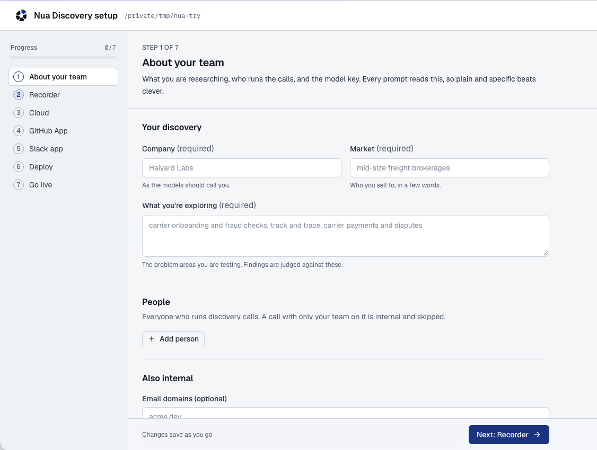
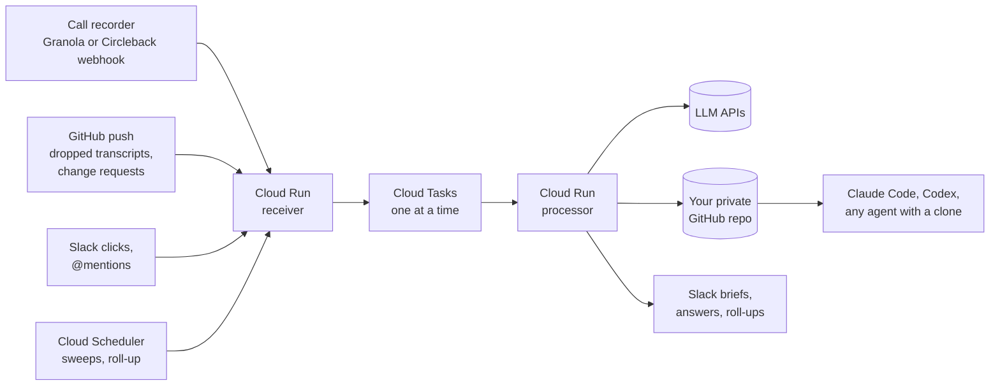

# Nua Discovery

**Finds the patterns across your customer calls, turns them into beliefs, and tests every new call against them.**

Call recorders summarize one call at a time. Nua Discovery reads all of them. It pulls findings out of each call with verbatim quotes, notices when the same thing keeps coming up across calls and across different kinds of customers, and proposes it as a belief. Once your team accepts a belief, every new call is checked against it, and Slack tells you the moment the evidence starts to turn.

## Get started

```sh
uv run python -m nua setup
```



1. On GitHub, click **Use this template** and make the new repo **private** (it will hold real conversations). Clone it.
2. Run `uv sync`, then `uv run python -m nua setup`. A local page opens and walks you through seven steps: your team, recorder (Granola or Circleback), cloud (Google Cloud or AWS), GitHub App, Slack app, deploy and go live. Every key has a "How do I get this?" guide, and everything saves as you go.
3. Run the one deploy command the page gives you. It shows each change and asks before applying it.

About an hour, most of it the cloud building. Full guides: [Google Cloud](docs/self-hosting.md), [AWS](docs/self-hosting-aws.md).

**Just looking?** Try it locally with no cloud and no keys: `uv run python -m nua run tests/fixtures/darius-kemp.md --dry-run --fake`. More in [docs/local-quickstart.md](docs/local-quickstart.md).

## What it does

Say you are building scheduling software for independent restaurants and talking to owners and managers every week.

**It finds the patterns for you.** Each Monday it groups the week's findings into themes and proposes beliefs once a theme shows up in 3+ calls from 2+ kinds of people:

```text
Add belief  P-014
"Shift swaps are arranged over group texts and the schedule is never updated"
Evidence: 4 calls in 3 seats
  • 2026-10-20_maria-lopez: "Half the time I find out someone swapped when the wrong person shows up."
  • 2026-10-14_dev-patel: "It all happens in the group chat, the paper schedule is fiction by Wednesday."
[Approve | Edit | Reject]
```

**It tests every new call against what you believe.** A few minutes after each call, Slack gets a brief that leads with what changed:

```text
Sam Okafor · Okafor's Grill · general manager · 32m · Alex · Granola

WHAT CHANGED
Contradicts B-002 "Owners would pay to stop building the schedule by hand"  [2/2 agree]
  "Building it takes me twenty minutes. It's the last-minute changes that kill me."
  Single location; B-002 came from multi-location owners. Likely split.
Supports B-001 "Shift swaps happen over text and get lost"  (now 6 calls, 3 seats)

5 new findings · 1 dodged question
```

When a belief is contradicted in 2+ calls from 2+ kinds of people, it is flagged as under pressure. You decide whether to keep, reword, split or retire it, and every change is checked back against all past calls. All names and quotes above are made up.

## Features

- **Verified quotes.** Every finding has 1 to 3 quotes, and code checks each one word for word against the transcript. Anything that does not match is dropped.
- **Two models, cross-checked.** Two models read each call and judge each finding against your beliefs; a third settles disagreements.
- **Breadth, not volume.** Evidence is counted by seat (the role someone speaks from), so three calls with the same kind of person never pass for a pattern.
- **People decide.** A finding only becomes a belief when someone approves it in Slack.
- **Ask across every call.** Mention the bot in Slack; it reads every call, not a sample, and says how many it read.
- **Pre-call prep.** Ask Claude Code or Codex to prep you; afterwards the brief says which questions got answered.
- **Your repo, plain files.** Transcripts, digests and beliefs are markdown and CSV in your private GitHub repo, readable by any AI agent.

## Configuration reference

The setup page and `nua init` write all of this for you. This section is for when you want to know what is where, or edit by hand.

**Committed to your repo** (the cloud reads them on every task, so a change needs no deploy):

| File | What it holds |
|---|---|
| `config/domain.yml` | `company`, `market` (who you sell to), `exploring` (the problems you are testing). Optional: `scope` (what each finding's line, party and segment mean in your market), `roles`, `institution_examples`, `bot_name`. Every prompt reads it |
| `config/people.yml` | Everyone who runs calls: an id (names their secrets and Circleback URL), name, and the email their calls are recorded under. Optional: `slack_id`, `circleback_key_name`, `github_login` |
| `config/pipeline.yml` | Model roles (`extractors`, `arbiter`, `ask_map`, `ask_reduce`, `rollup`), `prompt_version`, `ingest_cutoff` (go-live time), `timezone`, `internal_email_domains`, `cost_cap_usd_per_task`, Slack `channels`, and the `thresholds` for under pressure, new beliefs and retirements |
| `config/seats.yml` | Optional seed list of seats. The list grows from the calls by itself; add a seat here to steer the naming or merge two |
| `config/entities.yml` | Company and product names the transcripts garble ("guide wire" for Guidewire). Widens searches, never rewrites a quote |
| `config/overrides.yml` | Corrections to a call's contact, firm, seat, role or date, keyed by call id |
| `examples/` | Filled-in sample configs for two markets (`nua init --example <name>`) |

**Kept on your machine** (gitignored):

| File | What it holds |
|---|---|
| `.env` | Every secret: model keys (`GEMINI_API_KEY`, `ANTHROPIC_API_KEY`, `OPENAI_API_KEY`), recorder keys and webhook secrets, the GitHub App key and webhook secret, the Slack token and signing secret. The deploy script copies them to Secret Manager (GCP) or Secrets Manager (AWS); they never go into Terraform |
| `infra/terraform/terraform.tfvars` | Google Cloud settings: project, region, repo, GitHub App ids, budget, time zone, who records on Circleback, schedules on or off |
| `infra/aws/terraform/terraform.tfvars` | The same for AWS: region, architecture, budget emails and the rest |
| `.nua-setup.json` | The setup page's own choices (cloud, recorder, AWS profile) |

**Models.** The default runs every role on Gemini, so one key is enough. With Anthropic and OpenAI keys too, the setup page offers the cross-provider setup: those two extract and judge, Gemini arbitrates, and different providers catch more of each other's misses. See [Choosing models](docs/self-hosting.md#choosing-models). To pick models on your own market, draft labels with `nua label <transcript>`, correct them, and run `nua bakeoff --labels labels` (see `tests/labels/README.md`).

**Prompts.** [`nua/prompts/`](nua/prompts/): `extract.py` (what counts as a finding), `consolidate.py`, `verdict.py` and `arbiter.py` (checking findings against beliefs), `ask.py` (answering questions), `rollup.py` (weekly themes and proposals), `route.py` (Slack mentions). They hold no market of their own; the market comes from `domain.yml`. Bump `prompt_version` after changing `extract.py`, `verdict.py` or `arbiter.py`. Prompt changes ship with the code (`infra/deploy.sh`, or `infra/aws/deploy.sh`).

## Cost

| Item | Roughly |
|---|---|
| Google Cloud (Cloud Run scales to zero, Tasks and Scheduler free tiers, Secret Manager, Artifact Registry) | a few dollars a month |
| AWS (Lambda, SQS, a Fargate worker that scales to zero, Secrets Manager, ECR) | about $4 a month idle, $7 live |
| Models, per call | $0.25 to $2, depending on the models |
| Models, per Slack question | $0.25 to $2 (listing beliefs or findings, and greetings, are nearly free) |
| Granola Business (for webhooks and the API), or Circleback per person | per seat, see each recorder's pricing |

A per-task cost cap (`cost_cap_usd_per_task` in `config/pipeline.yml`) stops runaway model spend, and Terraform can add a monthly budget alert.

## Status

The core pipeline (recorder ingest, processing, Slack briefs and buttons, the Slack bot, roll-ups, backcheck, sweeps, CLI) runs in production for the team that built it.

Clouds: Google Cloud runs in production. AWS is built to the same design and has been deployed and run end to end on a live account (setup page, deploy, a call processed and committed, a roll-up posted to Slack, full teardown).

Recorders: Granola (one Business workspace) or Circleback (per person), or both at once. Circleback is turned on per person with `circleback_people` in Terraform; see [Self-hosting, step 8](docs/self-hosting.md#step-8-connect-your-recorder).

Experimental, off by default, built and tested but never run in production:

- **MCP server** (`service/mcp.py`): a claude.ai connector with read tools (`ask`, `list_calls`, `get_call`...) and write tools (`request_change`, `save_prep`). Deploy with `deploy_mcp = true` in Terraform.

Model ids in `config/pipeline.yml` change often. Check them against your provider before a first run.

## How it works



For each call the processor:

1. Parses the transcript and splits off the recorder's notes (context, never evidence).
2. Runs two extractors in parallel. Each returns who the contact is, a summary and findings with quotes.
3. Verifies every quote in code, with one repair round per miss.
4. Consolidates both models' findings with an arbiter.
5. Checks the findings against every belief and Watching item (two models, arbiter on disagreement) and grades your prep questions.
6. Writes `digests/<call id>.md`, regenerates `beliefs-status.md`, `findings.md`, `open-questions.md`, `calls.csv` and `claims.csv`, commits and pushes.
7. Posts the brief to Slack.

The diagram shows Google Cloud. On AWS the same pieces are a Lambda receiver, an SQS queue, a Fargate worker that scales to zero and EventBridge schedules. A nightly sweep and an hourly Granola-only sweep catch anything a webhook missed. Details: [docs/SPEC.md](docs/SPEC.md).

## Contributing

See [CONTRIBUTING.md](CONTRIBUTING.md). Run `uv run pytest` before you open a PR.

## License

MIT. See [LICENSE](LICENSE).

Built at Nua AI.
