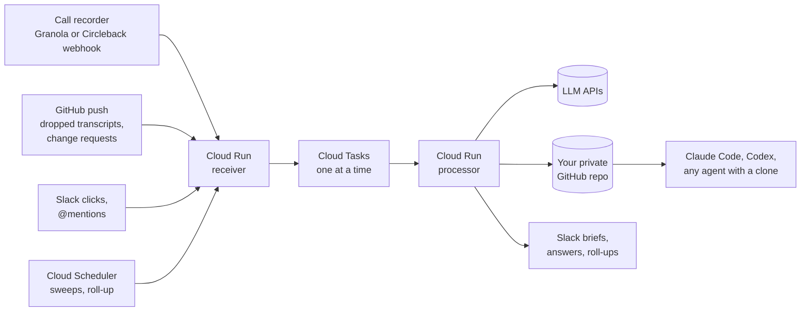

# Nua Discovery

**Your customer discovery calls, read in full, every time.**

Ask an AI tool "what do buyers say about pricing?" and it searches your call notes, pulls back a handful of chunks and answers from those. You never learn which 40 calls it skipped, and the quotes are often paraphrased.

Nua Discovery takes the other route. Every call is turned into a digest when it lands. Every question reads **every** digest and tells you so ("read 87/87 digests"). Every quote is checked character for character against the transcript by code, not by a model. And the things you are betting on are tracked as beliefs, with evidence for and against counted by the seat of the person who said it.

It runs on your call recorder, a private GitHub repo, Slack and a small Google Cloud project. Infra costs a few dollars a month.

## What you get in Slack

A few minutes after a call ends, a brief that leads with what the call changed:

```text
Dana Ortiz · Example Mutual · claims manager / supervisor · 41m · Alex · Granola
Touches D-001 (Footage triage tool for claims teams)

WHAT CHANGED
Contradicts B-003 "Most liability claims come with usable store footage"  [2/2 agree]  [Wrong read]
  "On the small accounts we get nothing usable maybe three times out of four."
  Small commercial carrier; B-003 came from large-account calls. Likely split.
Supports B-001 "Adjusters lose hours scrubbing footage for the incident"  (now 5 calls, 3 seats; new seat: claims manager / supervisor)
Watching W-002, supports "Buyers want review built into their claims platform"  (now 2 calls, 2 seats)

6 new findings · 1 dodged question
```

The thread holds the summary, each new finding with its quotes and a **Make belief / Watch** menu, and which of your prep questions were answered, dodged or never asked.

Ask across every call by mentioning the bot:

```text
@Nua Discovery what do claims managers say about footage retention? since:2026-09-01

Claims managers at small commercial carriers say footage is usually gone before the claim
arrives: stores overwrite it in 7 to 30 days and claims are often reported later. Two large
carriers keep it longer because their insureds retain it for their own risk teams.

Quotes
• 2026-10-20_dana-ortiz: "Most systems keep thirty days at best."
• 2026-10-14_ravi-menon: "By the time the claim hits my desk the video's been recorded over."
...
read 87/87 digests (since 2026-09-01)
```

All names, firms and quotes above are made up.

## Features

- **Reads every call.** Questions map over every digest with a cheap model and reduce with a strong one. The answer always ends with its coverage line.
- **Verbatim, verified quotes.** Two models extract findings (one point, 1 to 3 quotes each). Code checks each quote against the transcript body, ignoring only case, whitespace and punctuation, asks once for a repair on a miss, and drops what still fails. The recorder's AI summary is never quoted.
- **Cross-checked.** An arbiter model merges what both extractors found. Each finding is checked against your beliefs by two models (supports, contradicts or scope mismatch); a third settles disagreements.
- **Beliefs with evidence.** Beliefs (B-###) and Watching items (W-###) live in `beliefs.md`. `beliefs-status.md` shows the evidence for and against each, by seat, with quotes, and flags beliefs under pressure (contradicted in 2+ calls from 2+ seats).
- **Humans decide.** Only a person turns a finding into a belief: Slack buttons (Make belief, Watch, Wrong read, Keep, Reword, Split, Retire) or change-request files pushed by an agent. Every change gets a history line and a backcheck against every past call.
- **Weekly roll-up.** Mondays, findings are grouped into themes and the bot proposes new beliefs, promotions, splits and retirements, each with Approve / Edit / Reject.
- **Pre-call prep.** Ask Claude Code or Codex to prep you for a call; it writes up to 5 questions tagged with the beliefs they test, and the pipeline reports afterwards which ones got answered.
- **Repo is the source of truth.** Transcripts, digests, beliefs and indexes are plain markdown and CSV in your private GitHub repo. Any AI agent with a clone can answer from it (`AGENTS.md` tells it how).
- **Any market.** `config/domain.yml` describes your company, market and interviewees; every prompt reads it. `uv run python -m nua init` fills it in by asking a few questions, starting blank or from an example market in `examples/` (P&C insurance, freight brokerage).

## How it works



For each call the processor:

1. Parses the transcript and splits off the recorder's notes (context, never evidence).
2. Runs two extractors in parallel. Each returns who the contact is, a summary and findings with quotes.
3. Verifies every quote in code, with one repair round per miss.
4. Consolidates both models' findings with an arbiter.
5. Checks the findings against every belief and Watching item (two models, arbiter on disagreement) and grades your prep questions.
6. Writes `digests/<call id>.md`, regenerates `beliefs-status.md`, `findings.md`, `open-questions.md`, `calls.csv` and `claims.csv`, commits and pushes.
7. Posts the brief to Slack.

A nightly sweep and an hourly Granola-only sweep catch anything a webhook missed. Details: [docs/SPEC.md](docs/SPEC.md).

## Quickstart

**Local, 5 minutes, no cloud.** Clone, `uv sync`, add one Gemini key, drop transcripts into `transcripts/` and run:

```sh
uv run python -m nua run tests/fixtures/darius-kemp.md --dry-run --fake   # no key needed
uv run python -m nua backfill transcripts/
uv run python -m nua ask "what would they pay for?"
```

Full steps: [docs/local-quickstart.md](docs/local-quickstart.md).

**Self-hosted, about an hour.** Your own private repo, a Slack app, a GitHub App and Granola or Circleback webhooks, on Google Cloud or AWS. `uv run python -m nua setup` opens a local page that walks you through it; one bootstrap script runs the Terraform, secrets and build steps and asks before every change:

- Google Cloud: [docs/self-hosting.md](docs/self-hosting.md)
- AWS: [docs/self-hosting-aws.md](docs/self-hosting-aws.md)

## Make it yours

The quickest start is `uv run python -m nua setup`: a local page that walks through every step below and the cloud setup with forms. Or `uv run python -m nua init` in the terminal.

Everything specific to one team or market is in config and prompts, not code:

| To change | Edit |
|---|---|
| Company, market, problem areas, who you interview, scope fields, roles, bot name | `config/domain.yml`. Every prompt reads it |
| The seats you count evidence by (examples in `examples/*/seats.yml`) | `config/seats.yml` |
| Starting points and example markets | `examples/` (`nua init --example <name>`) |
| Time zone for call dates and schedules | `timezone` in `config/pipeline.yml` (default `America/Los_Angeles`); on the cloud, set Terraform's `time_zone` to match |
| Your team, their emails and Slack ids | `config/people.yml` |
| Slack channel names, models, cost cap, thresholds, go-live cutoff | `config/pipeline.yml` (`channels`, model roles, `cost_cap_usd_per_task`, `thresholds`, `ingest_cutoff`) |
| Company and product name aliases the transcripts garble | `config/entities.yml` |
| The prompts themselves | [`nua/prompts/`](nua/prompts/): `extract.py` (what counts as a finding), `consolidate.py`, `verdict.py` and `arbiter.py` (checking findings against beliefs), `ask.py` (answering questions), `rollup.py` (weekly themes and proposals), `route.py` (Slack mentions). They hold no market of their own: the market comes from `domain.yml`. Bump `prompt_version` in `config/pipeline.yml` after changing `extract.py`, `verdict.py` or `arbiter.py` |

To pick models on your own market, draft labels with `nua label <transcript>`, correct them, and run `nua bakeoff --labels labels` (see `tests/labels/README.md`).

Config changes take effect on the next task with no deploy. Prompt changes ship with the code (`infra/deploy.sh`).

## Cost

| Item | Roughly |
|---|---|
| GCP (Cloud Run scales to zero, Tasks and Scheduler free tiers, Secret Manager, Artifact Registry) | a few dollars a month |
| Models, per call | $0.25 to $2, depending on the models |
| Models, per Slack question | $0.25 to $2 (listing beliefs or findings, and greetings, are nearly free) |
| Granola Business (for webhooks and the API), or Circleback per person | per seat, see each recorder's pricing |

A per-task cost cap (`cost_cap_usd_per_task` in `config/pipeline.yml`) stops runaway model spend, and Terraform can add a monthly budget alert.

## Status

The core pipeline (recorder ingest, processing, Slack briefs and buttons, the Slack bot, roll-ups, backcheck, sweeps, CLI) runs in production for the team that built it.

Recorders: Granola (one Business workspace) or Circleback (per person), or both at once. Circleback is turned on per person with `circleback_people` in Terraform; see [Self-hosting, step 8](docs/self-hosting.md#step-8-connect-your-recorder).

Experimental, off by default, built and tested but never run in production:

- **MCP server** (`service/mcp.py`): a claude.ai connector with read tools (`ask`, `list_calls`, `get_call`...) and write tools (`request_change`, `save_prep`). Deploy with `deploy_mcp = true` in Terraform.

Model ids in `config/pipeline.yml` change often. Check them against your provider before a first run.

## Contributing

See [CONTRIBUTING.md](CONTRIBUTING.md). Run `uv run pytest` before you open a PR.

## License

MIT. See [LICENSE](LICENSE).

Built at Nua AI.
